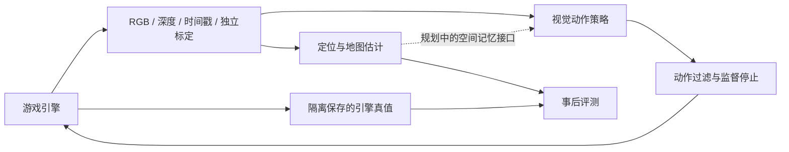

# 架构与证据边界

目标是在游戏引擎中形成可重复评测的 AI-NPC 闭环，当前模块尚未全部接通。

`ue5/GSVSLAM/Source/GSVSLAM` 负责采集、预热、路线及程序化场景；`ue5/tools` 提供离线几何与评测；`controller` 是既有 Windows 游戏控制实验。两条实验链路不代表已经实现引擎内自主 NPC。

## 数据与真值

采集会话包含 RGB、深度、元数据及相机真值。算法估计仅使用该方法声明允许的观测与独立标定；相机位姿真值只送入事后评测。`gt` 融合用于 oracle 对照时必须明确标注。

新增接口至少记录：协议版本、帧编号、单调时间戳与时钟来源、图像大小、内参、深度单位/有效值、坐标轴与左右手系、位姿方向、尺度来源、跟踪状态和延迟。当前尚无统一实时协议，不应把这些要求描述为已实现接口。

`inspect_slam_input.py` 提供只读输入合同检查，区分 RGB、RGB-D、视频和单独地图；合同通过不代表跟踪成功。内部诊断程序独立链接本地生成的 ORB 诊断库，前台按帧号、后台按关键帧编号记录事件；原安装保留。工具、生成的第三方源码副本和实验产物分开保存。

## 实验可信度

COLMAP 属于离线重建，RGB-D VO 不自动具备回环与重定位能力。`orbslam3_input.py`、`orbslam3/runner.cpp`、`orbslam3_report.py` 已提供输入隔离、固定顺序回放、原生产物审计和独立评分；可运行的适配器不等于连续跟踪通过。实时输入、延迟、丢帧、重定位及地图生命周期分别验收，使用说明见 [开发指南](development.md#orb-slam3-无真值顺序回放)。

程序正常退出、成功发送输入和游戏任务成功是不同结论。比较结果要同时报告覆盖率、失败段、轨迹/地图误差、延迟、参数、版本与数据标识，保留失败案例，不只展示最优运行。
